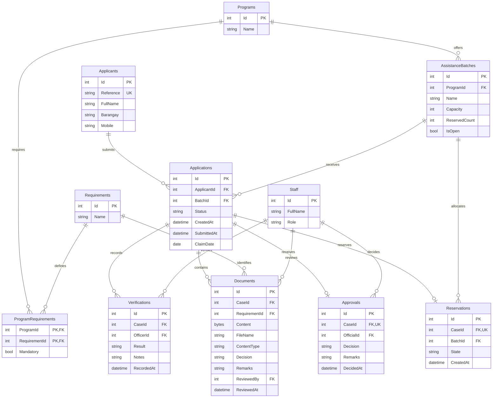

# Updated relational design

All entities below correspond to Data/DeskDb.cs and its generated EF Core migration/model snapshot. PK/FK relationships use restrictive deletion. A case belongs to one applicant and one batch. ProgramRequirement is the program/checklist many-to-many junction.

Database uniqueness: Applicants.Reference; Applications(ApplicantId,BatchId); Documents(CaseId,RequirementId); Reservations.CaseId; Approvals.CaseId; a partial unique Verifications.CaseId WHERE Result='Released'. ProgramRequirement has a composite key. Capacity has a CHECK requiring0<=ReservedCount<=Capacity and Capacity>0. Case/document/reservation allowed-state checks are in the migration.

Application invariants additionally coordinate batch count and reservation state in transactions. A database CHECK on one row alone cannot enforce the cross-table count. ReservedCount includes Reserved and Awarded reservations; Released denial reservations retain history without occupying capacity. Application state and a matching reservation are created together at submission. Approved/released awards retain their allocated slot.

Midterm revisions: AssistanceBatch/SlotReservation make capacity explicit. Current image bytes replace client-local image_path, so different API clients retrieve the same copy. NotificationLog and advisory AI flags are deferred. No document revision history is claimed. Demo staff roles identify an actor; they do not authenticate a real user.
